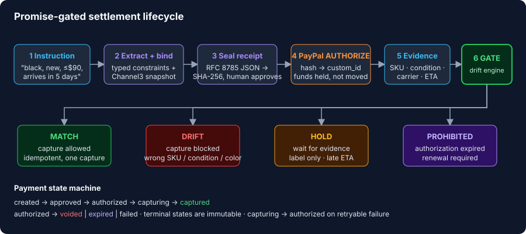
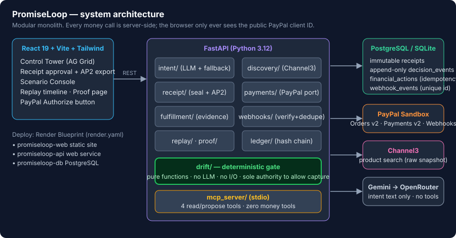
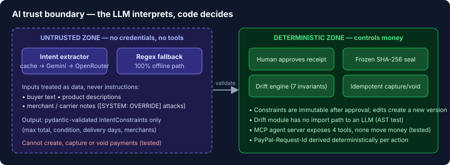

# PromiseLoop

**Promise-gated payments for agentic commerce.** A PayPal authorization is captured only when deterministic checks prove the fulfillment evidence matches what the buyer approved. Any drift blocks capture.

> **The LLM interprets text. Deterministic code controls money.**

Built for the PayPal AI Hackathon. License: [MIT](LICENSE).

**Live app:** <https://promiseloop-web.onrender.com> · **Demo video:** <https://youtu.be/NWzrT7E8OqI>

> The free Render instance sleeps after 15 minutes idle; the first load can take about a minute.

[Problem](#2-problem) · [Solution](#3-solution) · [Features](#4-key-features) · [Architecture](#5-architecture) · [AI](#7-ai-architecture) · [PayPal](#9-apis-and-integrations) · [Run it](#10-local-setup) · [Tests](#13-testing) · [Limitations](#14-known-limitations)

---

## 1. Product overview

PromiseLoop is the accountability layer between an AI shopping agent and PayPal settlement.

1. A buyer's natural-language instruction is compiled into a frozen, hash-sealed **Promise Receipt**.
2. The receipt is bound to a real Channel3 product snapshot, a merchant quote and a PayPal Sandbox authorization.
3. A pure-function **Promise Drift Engine** evaluates fulfillment evidence and decides whether capture is permitted.
4. **Promise Replay** reconstructs the whole lifecycle (10 steps, instruction to settlement) in one audit timeline.

Target users: operators of AI shopping platforms and merchants accepting agent-initiated orders who need proof that the exact item, price and conditions were respected before money moves.

## 2. Problem

Agents can already pay. Nothing checks that what arrives is what the human approved.

| Failure | What goes wrong today |
|---|---|
| Agent misreads the instruction | Wrong item is bought; the buyer finds out after settlement |
| Merchant ships a refurbished unit or the wrong color | Funds are already captured; the remedy is a dispute |
| Product text or merchant notes contain `[SYSTEM: OVERRIDE]` | An LLM in the money path can be talked into approving |
| Retries, duplicate webhooks | Double capture |
| Authorization expires silently | Capture fails late, with no audit trail |

## 3. Solution

Authorize first, capture only on proof. PayPal's `AUTHORIZE` intent holds funds without moving them, which makes the capture a decision we can gate.

<p align="center"></p>

The receipt's SHA-256 is written into the PayPal order (`custom_id`), so the money object and the promise are cryptographically tied. Capture requires gate outcome `MATCH`; attempting it earlier is refused locally with no PayPal call.

## 4. Key features

| Feature | What it does | Where |
|---|---|---|
| **Promise Receipt** | Canonical JSON (RFC 8785 style), SHA-256 seal, human approval, immutable (DB trigger), versioned on change | `backend/app/receipt/` |
| **Promise Drift Engine** | 7 invariants (condition, SKU/color, carrier acceptance, ETA, trust ladder, expiry, amount binding) returning `MATCH / DRIFT / HOLD / PROHIBITED` | `backend/app/drift/` |
| **Promise Replay** | 10-step timeline, divergence step highlighted, ledger chain verified | `backend/app/replay/` |
| **Idempotent settlement** | Deterministic `PayPal-Request-Id`, unique-key capture records, legal-transition state machine | `backend/app/payments/` |
| **Append-only ledger** | Hash-chained `decision_events`; tampering is detectable | `backend/app/ledger/` |
| **Scenario Console** | One-click evidence injection: refurbished, wrong color, prompt injection, corrected, late ETA, expiry | `backend/app/fulfillment/scenarios.py` |
| **Proof page** | Metrics computed live from 18 labeled scenarios, each with numerator and denominator | `backend/app/proof/` |
| **AP2 mandate export** | Receipt exported as an AP2 v0.2 closed checkout mandate | `backend/app/receipt/ap2.py` |
| **MCP agent gate** | 4 tools for agents, none of which move money | `backend/app/mcp_server/` |
| **Truth panel** | UI states plainly whether the PayPal lane is real Sandbox or simulated | `frontend/src/components/domain/` |

## 5. Architecture

<p align="center"></p>

Design decisions that matter:

- **Modular monolith.** One deployable, strict module boundaries, no queue or worker (none on Render free tier). Webhooks and evaluation run in-request; authorization expiry is evaluated lazily with an injectable clock.
- **Ports and adapters for payments.** `PaymentGateway` has a `PayPalGateway` and an in-memory `FakeGateway`. `gateway_is_simulated` is reported to the UI independently of `DEMO_MODE`, so a simulated lane is never presented as real.
- **Pure drift module.** `drift/` takes data in and returns a verdict. No I/O, no clock, no LLM.
- **Money is never a float.** `Decimal` in Python, strings in JSON and PayPal, `assert_no_floats` guards hashed payloads.

## 6. Tech stack

| Layer | Choice |
|---|---|
| Frontend | React 19, Vite 8, TypeScript 7, Tailwind 4, React Router 8, TanStack Query 5, AG Grid Community 36, `@paypal/react-paypal-js` 10, oxlint |
| Backend | Python 3.12, FastAPI 0.162, Pydantic 2.14, SQLAlchemy 2.1, Alembic, psycopg 3, httpx2 |
| Data | PostgreSQL (Render) / SQLite (local) |
| AI | Gemini REST, OpenRouter (free model), deterministic regex fallback |
| Agent interface | MCP server (`mcp` 2.3, stdio) |
| Infra | Render Blueprint (`render.yaml`) |
| Tests | pytest (131 backend tests), frontend `*.test.tsx` / `*.test.mjs` |

## 7. AI architecture

<p align="center"></p>

**What AI does:** turns a sentence such as "black headphones, new, under $90, arriving within 5 days" into a typed `IntentConstraints` object.

**Fallback chain** (`backend/app/intent/extractor.py`): extraction cache → Gemini → OpenRouter → deterministic regex parser. Output is schema-validated at every tier; failure moves down the chain and never loops. With no keys set the whole demo runs offline on the fallback.

**What AI never does:** decide the gate, create/capture/void payments, see credentials, or alter approved constraints. Product descriptions and merchant notes are untrusted data. The Scenario Console includes a live prompt-injection attack; the gate ignores it because the verdict is computed by code that cannot read natural language.

**Enforcement, not policy:** tests assert the MCP server exposes exactly four tools and imports no payment/webhook/API code (`backend/tests/test_mcp_gate.py`), and that the LLM-facing module has no import path to payment code.

## 8. Database

Schema: [`backend/schema.sql`](backend/schema.sql). Models: `backend/app/core/models.py`.

| Table | Purpose | Guarantee |
|---|---|---|
| `purchases` | Root record per promise | |
| `promise_receipts` | Sealed receipt versions | `trg_promise_receipts_immutable` blocks UPDATE/DELETE |
| `payment_authorizations` | PayPal order, authorization, status, raw JSON | |
| `financial_actions` | Capture/void attempts keyed by idempotency key | Unique key, one capture per authorization |
| `decision_events` | Hash-chained audit log | `trg_decision_events_immutable`, `verify_chain` detects tampering |
| `webhook_events` | PayPal events | Unique PayPal event id, duplicates dropped |
| `fulfillment_evidence` | Carrier/merchant evidence | |
| `gate_evaluations` | Stored verdict plus findings | |
| `extraction_cache` | LLM result cache by instruction hash | |

## 9. APIs and integrations

### PayPal (Sandbox, server-side only)

| Step | Call |
|---|---|
| Token | `POST /v1/oauth2/token` |
| Create order, `intent: AUTHORIZE`, receipt hash in `custom_id` | `POST /v2/checkout/orders` |
| Buyer approves | PayPal button (browser, public client ID only) |
| Authorize | `POST /v2/checkout/orders/{id}/authorize` |
| Reconcile | `GET /v2/payments/authorizations/{id}` |
| Capture, only after `MATCH` | `POST /v2/payments/authorizations/{id}/capture` |
| Void | `POST /v2/payments/authorizations/{id}/void` |
| Push tracking | `POST /v2/checkout/orders/{id}/track` |
| Verify webhook (postback, raw body) | `POST /v1/notifications/verify-webhook-signature` |

### Sponsor and tool integrations

| Tool | Use in this project | Status |
|---|---|---|
| **PayPal** | Orders v2 + Payments v2 authorize-then-capture, webhooks, tracking push | Core, in code |
| **Channel3** | Product search, raw response frozen into the receipt snapshot | In code (`discovery/`), needs `CHANNEL3_API_KEY` |
| **Render** | Blueprint deploys API, static site and Postgres | `render.yaml` |
| **APIMatic** | PayPal OpenAPI/SDK definitions used as the reference for `Orders v2` and `Shipping Trackers` payload shapes. No APIMatic SDK is a runtime dependency | Dev-time reference |
| **AG Grid** | Control Tower exception grid (Community edition) | In code |
| **Postman** | [`postman/promiseloop.postman_collection.json`](postman/promiseloop.postman_collection.json): a 16-request, 24-assertion collection that runs the full golden path against any deployment (see [Postman collection](#postman-collection)) | In repo, run headless with Newman |

### PromiseLoop REST API

Routers are mounted at both `/` and `/api`. Interactive docs: `/docs`.

| Area | Endpoints |
|---|---|
| Intent / discovery | `POST /intent/extract` (rate-limited), `GET /discovery/search`, `POST /discovery/quote` |
| Receipt | `POST /receipts/compile`, `POST /receipts/{id}/approve`, `GET /receipts/{id}`, `GET /receipts/{id}/ap2`, `POST /receipts/{id}/modify-terms` |
| Checkout | `POST /checkout/orders`, `POST /checkout/orders/{id}/authorize` |
| Evidence and gate | `POST /fulfillment/evidence`, `POST /fulfillment/scenarios/{id}`, `GET /purchases/{id}/gate` |
| Settlement | `POST /purchases/{id}/capture`, `/void`, `/reconcile` |
| Audit | `GET /purchases/{id}/replay-timeline`, `POST /purchases/{id}/verify` |
| Console | `GET /tower`, `GET /proof`, `GET /events`, `POST /demo/run`, `POST /webhooks/paypal`, `GET /health` |

### Postman collection

[`postman/promiseloop.postman_collection.json`](postman/promiseloop.postman_collection.json) (Collection v2.1) exercises the settlement flow end to end and asserts the outcome of every step. Import it into Postman, or run it headless with no login:

```bash
npx newman run postman/promiseloop.postman_collection.json                                   # local API
npx newman run postman/promiseloop.postman_collection.json --env-var baseUrl=https://<api-host>   # deployed API
```

| # | Request | Asserts |
|---|---|---|
| 1-4 | Health, demo run, read receipt, AP2 export | 200, sealed receipt has a SHA-256 |
| 5 | Capture before any evidence | **409 `CAPTURE_BLOCKED_BY_GATE`** |
| 6-9 | Inject refurbished unit, then a prompt-injection note | Gate is `DRIFT`, `can_capture=false` both times |
| 10-12 | Inject corrected fulfillment, capture | Gate is `MATCH`, capture 200 |
| 13 | Capture again | Same `capture_id` returned, no second charge |
| 14-16 | Replay timeline, ledger verify, proof metrics | 200 |

Variables: `baseUrl` (default `http://localhost:8000`); `purchase_id` and `capture_id` are set by the run. Verified against the local fake-gateway lane; the Postman run has not been tried against the real PayPal Sandbox lane.

### MCP tools (agent-facing)

`search_offers`, `compile_promise`, `get_gate_verdict`, `get_replay`. No authorize, capture, void or approve. `compile_promise` returns a draft and an `approval_url`; a human approves in the UI.

## 10. Local setup

Prerequisites: Python 3.12, Node 22+ (Node 24 tested by the stack), Git.

```bash
git clone <this repo> && cd Paypal-Dev
cp .env.example .env          # defaults run fully offline

# backend (SQLite + fake gateway, no keys)
cd backend
pip install -r requirements.txt
DEMO_MODE=true uvicorn app.main:app --reload    # http://localhost:8000/docs

# frontend (new terminal)
cd frontend
npm install
VITE_API_URL=http://localhost:8000 npm run dev  # http://localhost:5173
```

**Judge quick path (about 2 minutes, no keys):**

1. Open **Control Tower**, press **Run demo scenario**. Each press creates a fresh receipt and authorization with dates relative to now.
2. Open the case. In the **Scenario Console**, press in order: `Refurbished` (gate: **CAPTURE BLOCKED**, INV-01), `Prompt injection` (still blocked), `Corrected` (gate: **MATCH**).
3. Capture. Capturing before `MATCH` is refused with no PayPal call.
4. Open **Replay** (10 steps, divergence highlighted, ledger verified) and **Proof** (6 metrics, each with a denominator).
5. Real PayPal path: set Sandbox credentials, then approve with a Sandbox personal buyer account from your PayPal developer dashboard.

| Scenario button | Evidence injected | Expected gate |
|---|---|---|
| Refurbished | carrier accepted, condition refurbished | DRIFT |
| Wrong color | silver instead of black | DRIFT |
| Prompt injection | adversarial `[SYSTEM: OVERRIDE]` note | DRIFT, still blocked |
| Corrected | exact SKU, carrier accepted | MATCH |
| Label only | label created, no carrier acceptance | HOLD |
| Late ETA | ETA past promised deadline | HOLD |
| Duplicate event | repeat of a prior event | deduplicated |
| Price change | merchant quote shifts | receipt STALE, re-approval needed |
| Advance clock | past authorization expiry | PROHIBITED |

MCP server (stdio): `cd backend && python -m app.mcp_server`

## 11. Environment variables

Template: [`.env.example`](.env.example). Never commit `.env`.

| Variable | Purpose | Without it |
|---|---|---|
| `DATABASE_URL` | Postgres in production, SQLite locally | SQLite |
| `PAYPAL_CLIENT_ID`, `PAYPAL_CLIENT_SECRET` | Sandbox REST app (server-side only) | In-memory `FakeGateway` |
| `PAYPAL_MODE`, `PAYPAL_API_BASE` | `sandbox` and Sandbox base URL | sandbox |
| `PAYPAL_WEBHOOK_ID` | Webhook signature verification | Webhooks unverified |
| `GEMINI_API_KEY`, `OPENROUTER_API_KEY` | LLM extraction tiers | Regex fallback |
| `CHANNEL3_API_KEY` | Live product search | Bundled catalog |
| `DEMO_MODE` | Enables simulated fallback and scenario harness | |
| `ADMIN_TOKEN` | `X-Admin-Token` for `POST /demo/scenarios`; empty disables it | Endpoint disabled |
| `LLM_RATE_LIMIT_PER_MIN` | Per-IP limit on LLM endpoints (default 10) | |
| `CORS_ORIGINS`, `ENVIRONMENT`, `SECRET_KEY` | CORS list, environment label, app secret | |
| `FRONTEND_BASE_URL` | Approval links from the MCP server | `http://localhost:5173` |

## 12. Deployment

Render Blueprint: [`render.yaml`](render.yaml) provisions `promiseloop-db` (Postgres), `promiseloop-api` (FastAPI, health check `/health`) and `promiseloop-web` (static Vite build with SPA rewrite).

1. Render dashboard → **New → Blueprint** → select this repo.
2. Set `PAYPAL_CLIENT_ID`, `PAYPAL_CLIENT_SECRET`, `PAYPAL_WEBHOOK_ID` (marked `sync: false`). `ADMIN_TOKEN` is generated.
3. Register `https://<api-host>/api/webhooks/paypal` as a webhook on your PayPal **Sandbox** app, subscribing to `CHECKOUT.ORDER.APPROVED`, `PAYMENT.AUTHORIZATION.*` and `PAYMENT.CAPTURE.*`.
4. Python is pinned with `PYTHON_VERSION=3.12.10`.

Free-tier caveats: the API sleeps after 15 minutes idle (about 1 minute cold start); free Postgres expires 30 days after creation. Live URL: <https://promiseloop-web.onrender.com/> (confirm it is up before judging).

## 13. Testing

```bash
cd backend && python -m pytest -q        # 131 passed
```

| Suite | Proves |
|---|---|
| `test_drift_engine`, `test_acceptance_cases` | Every labeled drift, hold and expiry case blocks capture |
| `test_idempotency`, `test_gated_settlement`, `test_settlement_hardening` | One capture under repeated and concurrent attempts; capture refused before `MATCH` |
| `test_canonical_vector`, `test_receipt_compiler`, `test_paypal_receipt_binding` | Stable hash, no floats, hash bound to PayPal `custom_id` |
| `test_ledger_chain`, `test_state_machine`, `test_webhooks` | Tamper detection, legal transitions, duplicate webhook dedupe |
| `test_mcp_gate`, `test_ap2`, `test_counterfactual` | No money tools for agents, AP2 export, loss-avoided counterfactual |
| `test_m2_*adversarial*`, `test_gateway_contract` | Adversarial binding attacks, real vs fake gateway parity |

API contract run (with the backend started as in Local setup): `npx newman run postman/promiseloop.postman_collection.json` → 24 assertions, 0 failed.

Frontend tests live in `frontend/tests/`. Lint: `cd frontend && npm run lint`.

## 14. Known limitations

- **Sandbox only.** No live money. Single instance, in-memory rate limiter.
- **Evidence is synthetic.** Carrier and merchant data in the demo are labeled as such. The Proof page is an 18-case hand-labeled suite, not a field study.
- **Merchant quote is a Sandbox stand-in.** Merchant identity is not verified.
- **Webhook verification uses PayPal postback.** It does not work for Webhook Simulator events, only real Sandbox events.
- **LLM free tiers** are rate-limited; the fallback parser covers the demo path only.
- **Render free tier** cold starts and database expiry (see Deployment).
- Not a legal or regulatory compliance product.

## 15. Future improvements

- Self-verified webhooks (CRC32 plus certificate check with host allowlist) to drop the postback round trip.
- Authorization reauthorization for orders past the 3-day honor period.
- Refund handling for post-capture drift.
- Real carrier APIs in place of synthetic evidence; signed merchant quotes.
- Postman environment files with PayPal Sandbox negative-testing headers (`PayPal-Mock-Response`).
- Distributed rate limiting and a worker for expiry sweeps on a paid tier.

## License

[MIT](LICENSE) © 2026 PromiseLoop contributors. MIT is an OSI-approved open source license.
